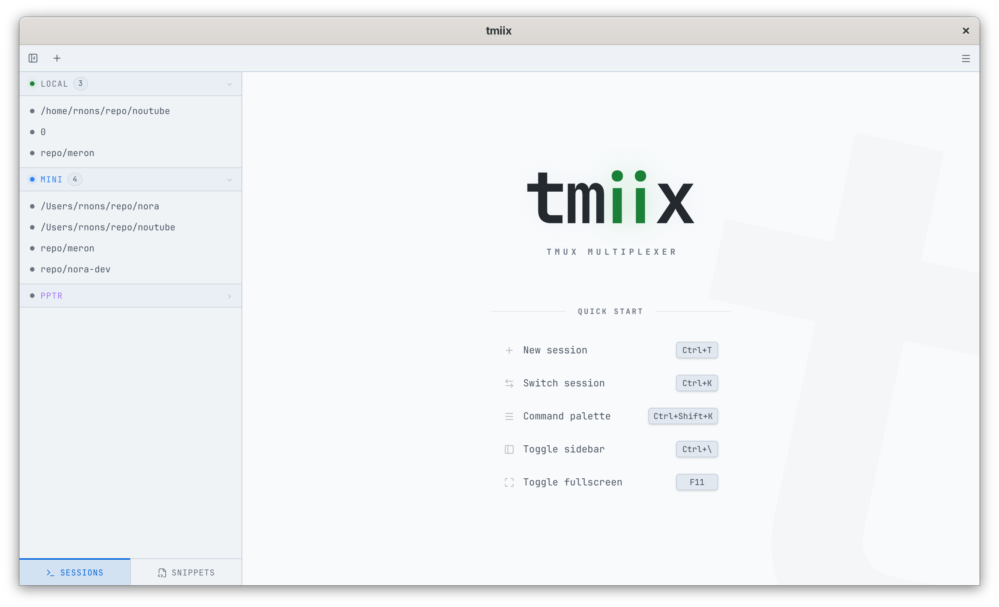
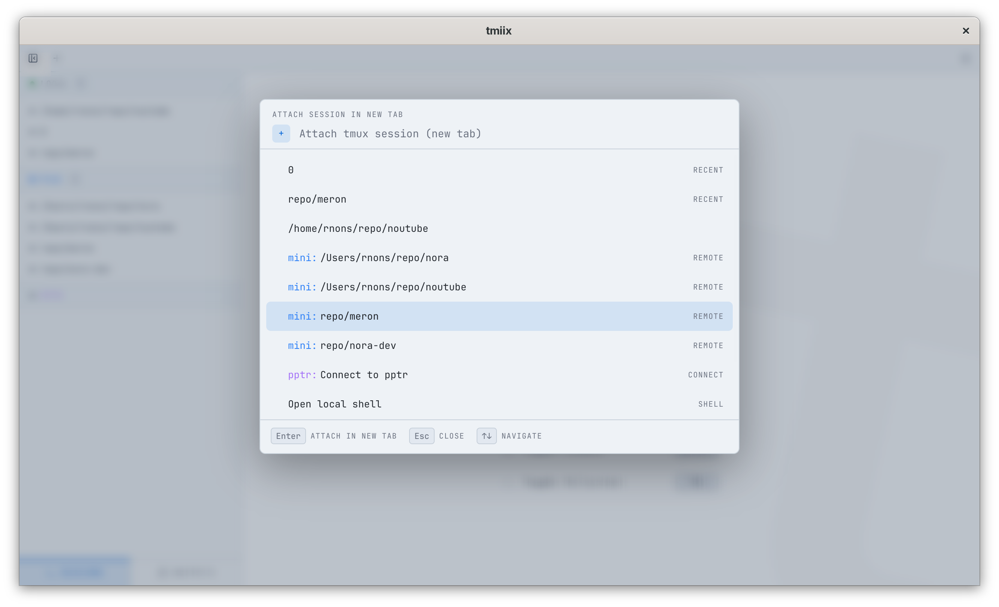

<h1 align="center">Tmiix</h1>
<div align="center">
  <p>Tmux and SSH session manager</p>
  
</div>

Tmiix is a terminal with builtin tmux, ssh and snippets support. Tmiix manages local and remote [tmux](https://github.com/tmux/tmux) sessions in a beautiful, intuitive, fast UI.

[](https://github.com/nonbili/tmiix/releases/latest)

## Features

- Manage tmux sessions on local and SSH servers
- Manage shell snippets to run on local and SSH servers
- Paste clipboard image directly into AI coding agent on SSH servers
- UI to upload files to SSH servers
- Keyboard shortcuts to quickly switch sessions
- Fully customizable

## Screenshots

| Quick start |
| --- |
|  |

| Snippets | Session switcher |
| --- | --- |
|  |  |

| Tmux session | Command palette |
| --- | --- |
|  |  |

## Development

Required: Go 1.26+, [Bun](https://bun.sh/), and [Wails v3](https://v3.wails.io/).
On Linux, install GTK3 and WebKitGTK 4.1 development packages (for example,
`libgtk-3-dev libwebkit2gtk-4.1-dev` on Ubuntu). This project uses Wails' `gtk3`
compatibility backend.

Install the matching CLI (the `gtk3` tag is only needed on Linux):

```sh
go install -tags gtk3 github.com/wailsapp/wails/v3/cmd/wails3@v3.1.0
```

Build and development commands use Wails' standard Taskfile tooling. No
experimental build-system environment variables are required. Application metadata
(including the version) lives in `build/config.yml`.

Run live development mode with:

```sh
wails3 dev
```

## Build

Build the production desktop app:

```sh
wails3 build
```

The resulting binary will be in `build/bin/`.

On macOS, the build produces `build/bin/tmiix.app`.

Run tests with `go test -tags gtk3 ./...` and `cd frontend && bun test`.
